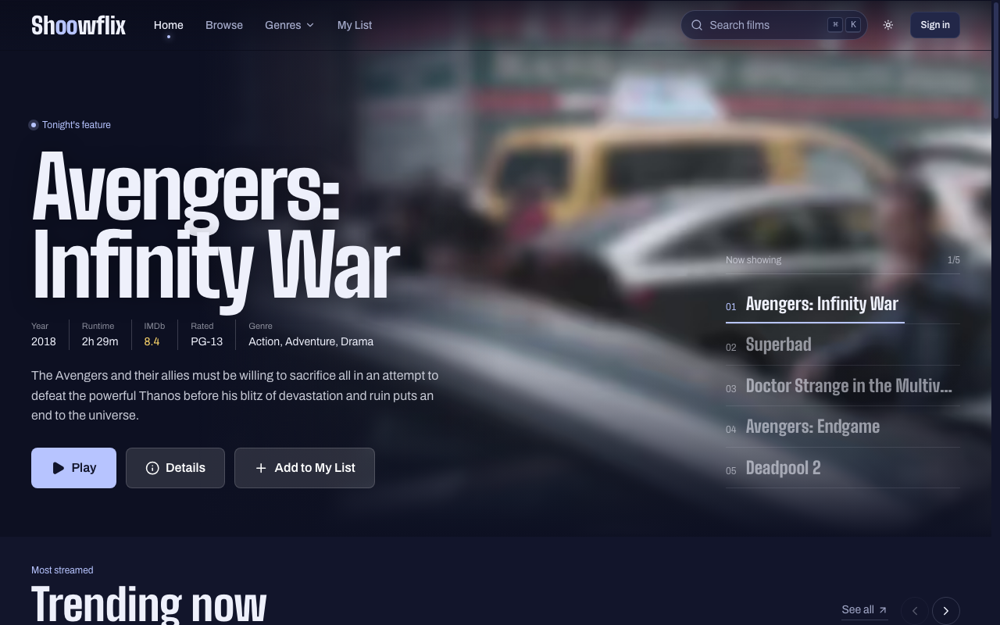

# Shoowflix

A film discovery and streaming web app built on the Next.js App Router. Browse the YTS catalogue, save films to your list, and stream them in the browser through the Webtor player.



> **Educational project.** Shoowflix is a non-commercial project built to learn and demonstrate modern web development. It doesn't host, store or upload any media. Film listings come from the public YTS catalogue, and video streams from peer-to-peer networks through Webtor, a third-party player. Copyright law differs by country; you're responsible for following the law where you live.

## Features

- **Discovery:** home page with a featured carousel, trending, new and top-rated rails, genre pages, filters, search, and a ⌘K quick search.
- **Film pages:** synopsis, cast, trailer, and a quality list with size and seed counts.
- **Streaming:** custom player around Webtor with quality switching, resume, Continue Watching, keyboard shortcuts, and automatic recovery when a stream stalls.
- **Accounts:** sign in with Google or email and password, My List, profile, and Continue Watching synced across devices.
- **Access:** browsing is public; streaming needs a signed-in account and acceptance of the terms.
- **AI picks:** describe a mood and get suggestions (uses OpenAI when configured).

## Tech stack

| Area | Choice |
|---|---|
| Framework | Next.js 16 (App Router, Turbopack), React 19, TypeScript 5.9 |
| Data fetching | Server Components with the Next fetch cache; SWR 2 in the browser |
| Auth | NextAuth 4 (JWT sessions), Google OAuth and credentials |
| Database | MongoDB through Prisma 6 |
| Validation | Zod |
| Styling | CSS Modules and design tokens; no CSS or component framework |
| Player | Webtor embed SDK (loaded from a pinned CDN URL with SRI) |
| Hosting | Built for Vercel (`output: "standalone"` also works on any Node host) |

## Getting started

Requires Node.js 20.9 or newer and a MongoDB database.

```bash
git clone <your-fork-url> shoowflix
cd shoowflix
npm install                  # also runs `prisma generate`
cp .env.example .env.local   # then fill in the values
npm run db:push              # create collections and indexes
npm run dev                  # http://localhost:3000
```

### Environment variables

All variables live in `.env.local`. See [`.env.example`](.env.example) for the template.

| Variable | Required | Purpose |
|---|---|---|
| `DATABASE_URL` | Yes | MongoDB connection string |
| `NEXTAUTH_URL` | Yes | Base URL of the site |
| `NEXTAUTH_SECRET` | Yes | Signs sessions and the terms cookie. Generate with `openssl rand -base64 32` |
| `GOOGLE_CLIENT_ID`, `GOOGLE_CLIENT_SECRET` | For Google sign-in | Google OAuth credentials |
| `NEXT_PUBLIC_API_ROOT` | Yes | YTS API root, for example `https://yts.gg/api/v2` |
| `NEXT_PUBLIC_SITE_URL` | Recommended | Public URL for canonical links, sitemap and Open Graph |
| `NEXT_PUBLIC_WEBTOR_URL` | No | Webtor instance for the player. Defaults to `https://webtor.io`; see [Self-hosting the player](#self-hosting-the-player) |
| `OPENAI_API_KEY`, `OPENAI_MODEL` | No | Enables model-based AI picks |

## Scripts

| Command | What it does |
|---|---|
| `npm run dev` | Start the dev server |
| `npm run build` | Production build |
| `npm start` | Serve the production build |
| `npm run lint` | ESLint |
| `npm run typecheck` | TypeScript check |
| `npm run db:push` | Sync the Prisma schema to MongoDB (reads `.env.local`) |
| `npm run db:studio` | Open Prisma Studio (reads `.env.local`) |

## Project structure

```
app/                 Routes (Server Components by default)
  api/               Route handlers: movies, watchlist, progress, register, AI picks, vitals, disclaimer
  watch/[id]/        Player (signed in + terms accepted)
  movie/[id]/        Film pages (ISR)
  genre/, browse/, search/, my-list/, profile/, (auth)/, disclaimer/
components/
  ui/                Design-system primitives (dialog, menu, toast, tabs, inputs, images)
  shell/             Header, footer, mobile tab bar, ⌘K search
  movie/             Cards, rails, grid, hero, film page sections
  discovery/         Genre showcase, filters, infinite lists, AI picks
  player/            Player stage, Webtor wrapper, panels
  account/           Watchlist and watch buttons
  perf/              Web vitals, service worker registration, player warm-up
hooks/               Client hooks (movies, watchlist, Continue Watching, player)
lib/                 Data layer (yts.ts), auth, Prisma, SWR helpers, disclaimer signing
lib/server/          Server-only helpers: HTTP, schemas, rate limiting, movie snapshots
styles/              Design tokens and global CSS
prisma/              Schema
proxy.ts             Access checks for /watch, /profile and /my-list
```

## How it works

### Rendering

| Route | Mode |
|---|---|
| `/` | Static, revalidated every 30 minutes. Below-the-fold sections stream in. |
| `/genre/[genre]` | All genres pre-built, revalidated hourly, infinite scroll on the client. |
| `/movie/[id]/[slug]` | Top 40 pre-built, others built on first visit, revalidated every 6 hours. Includes metadata, JSON-LD and canonical-slug redirects. |
| `/browse`, `/search` | Rendered per request; first page on the server, more via SWR. |
| `/watch/[id]`, `/profile`, `/my-list` | Rendered per request, signed in only. |

Server pages read YTS through `lib/yts.ts`, which caches every request with a revalidate time and tags, times out after 10 seconds and retries once. Personal UI (the header's account menu, watchlist buttons, "Sign in to watch") are small client components, so shared pages stay static.

### Access

- **Browsing is public** and indexable. Public pages and APIs never include torrent hashes, magnet links or `.torrent` URLs; they're removed in the data layer.
- **`/watch` needs the terms and an account.** `proxy.ts` checks a signed `HttpOnly` cookie set when the visitor accepts the disclaimer (HMAC with `NEXTAUTH_SECRET`, versioned, valid for 24 hours), then the session. The watch page checks the session again on its own.

### Player

Webtor runs in a cross-origin iframe, so the player stage is a small state machine driven by the SDK's events. It starts from the film's `.torrent` file to skip fetching metadata from peers, falls back to the magnet link if that fails or stalls, and switches once to the healthiest other quality if a start stalls for 20 seconds. The default quality is chosen by swarm health, file size and codec.

### Performance

Self-hosted fonts, one preloaded hero image, image sizes matched to layouts, skeletons that match real components to avoid layout shift, streaming with Suspense, `content-visibility` for long pages, code-split client islands, a click-to-load trailer, early loading of the player script, a service worker for static assets and posters, and real-user Web Vitals reporting to `/api/vitals`.

More detail on the original architecture and component contracts is in [`docs/ARCHITECTURE.md`](docs/ARCHITECTURE.md).

## Self-hosting the player

The player is a Webtor iframe. With the default `https://webtor.io` it's a cross-site iframe, and Safari, every iOS browser and Brave block its cookies, so Webtor's CSRF check fails ("CSRF token mismatch"). On those browsers the watch page offers webtor.io in a new tab instead.

Running [Webtor self-hosted](https://github.com/webtor-io/self-hosted) on a subdomain of your site makes the iframe same-site, and the player works everywhere:

1. On a server with Docker and plenty of bandwidth (every stream passes through it), run the container with your subdomain:
   ```bash
   docker run -d -p 8080:8080 \
     -e DOMAIN=https://stream.example.com \
     -e ADMIN_PASSWORD=change-me \
     -v data:/data -v pgdata:/pgdata -v storage:/storage \
     --name webtor --restart=always ghcr.io/webtor-io/self-hosted:latest
   ```
2. Point `stream.example.com` at the server and serve it over HTTPS with a reverse proxy (Caddy, nginx). HTTPS is required.
3. In the instance's profile page, add your site's domain (e.g. `www.example.com`) to the embed domain list.
4. Set `NEXT_PUBLIC_WEBTOR_URL=https://stream.example.com` and redeploy.

The server joins torrent swarms itself, so its IP address is visible to peers and its host's terms and local copyright law apply to it.

## Deployment

1. Set the environment variables in your host (on Vercel: Project Settings → Environment Variables). Use a new `NEXTAUTH_SECRET` for production.
2. Add `{your-domain}/api/auth/callback/google` as an authorised redirect URI in Google Cloud.
3. Run `npm run db:push` against the production database once, and again after schema changes.
4. Deploy. The build pre-renders the home, genre and top film pages; if YTS is unreachable during the build, those pages render empty and fill in on their next revalidation.

## Credits

Film data from [YTS](https://yts.gg). Streaming by [Webtor](https://webtor.io). Not affiliated with any studio or streaming service.

## License

[MIT](LICENSE)
